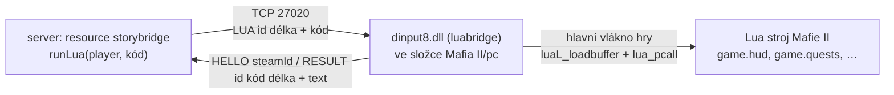
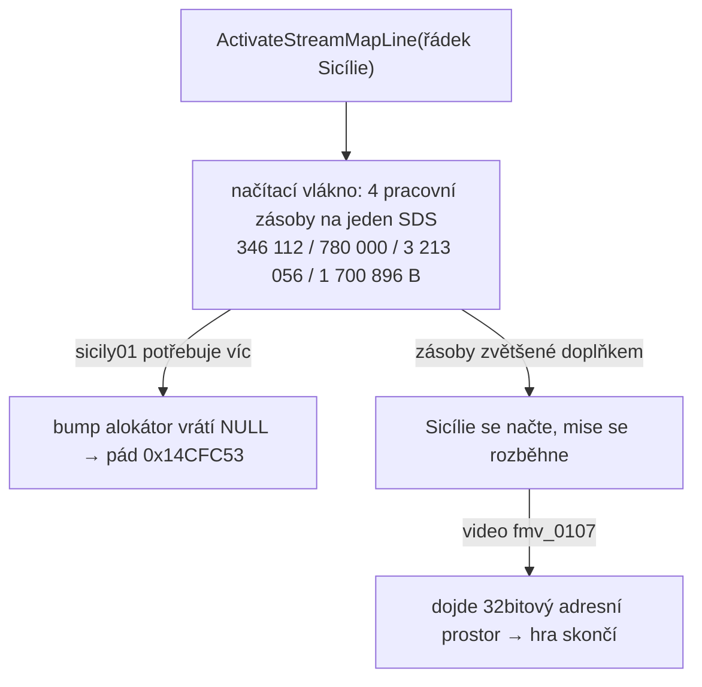

# M2O (Mafia 2 Online) – poznatky pro vývoj módu

Znalosti nastudované z dokumentace [docs.mafia2online.com](https://docs.mafia2online.com/) (Scripting API **v1.7.0**, říjen 2026), ověřené na skutečném serveru v Dockeru (build **M2O-1.7.0**, teď **1.7.1**, framework 40.1.0) a připojením ze hry (Mafia II Classic přes Steam/Proton). Body označené **[ověřit]** dokumentace neříká jednoznačně nebo si odporuje a ověřit je zatím nešlo. Než na nich něco postavíš, vyzkoušej je ve hře.

- Dokumentace: <https://docs.mafia2online.com/> (průvodci `/guides/…`, generovaná reference `/reference/server/…` a `/reference/client/…`)
- Typy pro editor: npm [`@mafia2online/types`](https://www.npmjs.com/package/@mafia2online/types) (`/server` a `/client`)
- Klient i serverové soubory: Discord M2O, kanál **#downloads** (<https://discord.gg/qKvWCnz>); M2O V2 je ve veřejné open betě

---

## 1. Struktura tohoto repa

```
m2o_playground/
├── compose.yaml              # docker compose – server M2O
├── m2o-cmd.sh                # pošle příkaz do konzole serveru (restart resource, refresh, status…)
├── play-m2o.sh               # spustí klienta M2O přes Proton v prefixu Mafie II (Steam appid 50130)
├── native/luabridge/         # nativní doplněk hry (dinput8.dll): Lua v enginu ze serveru
├── tools/
│   ├── sds.py                # rozbalovač SDS archivů Mafie II pro Linux (Python, port Gibbed.Illusion, i šifrované)
│   ├── decompile-lua.sh      # dekompilace Lua bytecode misí přes unluac (Java)
│   ├── streammap.py          # StreamMapa.bin: co načítá který řádek, přestavba řádku (Sicílie v M2O)
│   └── sdsconfig.py          # edit/sdsconfig.bin: výpis a úprava slotů SDS
├── docker/
│   ├── Dockerfile            # Ubuntu 24.04 + knihovny, BEZ binárek serveru
│   └── entrypoint.sh         # zkopíruje binárky, nalinkuje server.json, spustí M2OServer
├── server/                   # binárky ze server-linux/ (M2OServer, libnode.so.147, crashpad_handler; gitignore)
├── config/server.json        # konfigurace serveru
├── data/                     # perzistentní data módu (JSON/SQLite) → /opt/m2o/data
├── logs/                     # log soubory serveru (framework.log)
└── resources/
    ├── playground/           # náš ukázkový resource (server + client), typy, `npm run check`
    ├── storybridge/          # most k luabridge: runLua(player, kód) přes TCP 27020
    ├── m2o-demo/             # oficiální demo z buildu – ~3 600 ř. serveru + 1 000 ř. klienta, nejlepší vzor API
    ├── shared-utils/         # oficiální knihovna (exports), na ní závisí m2o-demo
    └── m2o-test/             # oficiální self-test vozidel; nečinný bez proměnné M2O_SELFTEST
                              # (oficiální resources nejsou v gitu – kopírují se z build archivu)
```

---

## 2. Docker na Linuxu

### Co server potřebuje (z [Linux dedicated server](https://docs.mafia2online.com/guides/server/linux-dedicated-server/))

- Build archiv `M2O-<verze>.zip` obsahuje složky `client/` (Windows klient), `server/` (Windows server), `server-linux/` a `resources/`. Ve `server-linux/` jsou:
  - `M2OServer`: server;
  - `libnode.so.<N>`: vestavěný Node.js, ve kterém běží serverové skripty. Dokumentace uvádí `.141`, **build 1.7.0 má `.147` (Node v26.12.1)**, entrypoint proto bere libovolnou verzi;
  - `crashpad_handler`: hlášení pádů;
  - `resources/`: oficiální resources `m2o-demo`, `shared-utils` a `m2o-test`.
- x86-64 a **glibc ≥ 2.38**, tedy Ubuntu 24.04+ nebo Debian 13+. Na Ubuntu 22.04 / Debianu 12 server nenaběhne, proto je základem image `ubuntu:24.04`.
- Knihovny: `libatomic1 libstdc++6 libgcc-s1 libcurl4 openssl ca-certificates`. Na Ubuntu 24.04 se balík jmenuje `libcurl4t64`.
- Proměnné prostředí:
  - `LD_LIBRARY_PATH=<složka serveru>`: loader najde `libnode.so.*`;
  - `TRACY_NO_INVARIANT_CHECK=1`: bez ní server na VPS nebo starším CPU spadne hned po startu s kódem 1 a bez hlášky. Nastavuj ji vždy.
- Porty:
  - **UDP 27015**: herní provoz (`port` v `server.json`);
  - **TCP 27016** (`port + 1`): HTTP endpoint s metadaty serveru pro server browser a masterlist.

### Proč je to udělané takhle

- **Binárky nejsou v image**, připojují se ze `./server` jen pro čtení. Nový build serveru = rozbalit a restartovat kontejner, image se nepřestavuje. Binárky se navíc nedostanou do registry.
- **Entrypoint binárky při startu zkopíruje** do `/opt/m2o` vedle `server.json`, `resources/` a `data/`. Server totiž čeká vše „vedle sebe“ a zip nemusí zachovat spustitelný bit.
- **`server.json` je ve složce `./config`** a do `/opt/m2o` se jen nalinkuje.
  - Docker Desktop při připojení samotného souboru (`./server.json:/opt/m2o/server.json`) soubor na hostu **vynuloval**, a vnořené připojení souboru do jiného připojení vůbec nenaběhne. Ověřeno na tomhle stroji (Docker Desktop, kontext `desktop-linux`).
  - Pokud `server.json` chybí, server ho při prvním startu vytvoří s výchozími hodnotami. Přes odkaz se rovnou zapíše do `./config`.
- Kontejner běží pod uživatelem `ubuntu` (UID 1000), takže soubory v připojených složkách patří stejnému UID jako na hostu.
- `tini` jako PID 1 předává signály, takže `docker compose stop` server korektně ukončí.
- `stdin_open` + `tty`: konzole serveru přijímá příkazy přes `docker attach`.

### Postup

```bash
cd ~/Documents/m2o_playground

# 1. Binárky z build archivu do ./server (archiv je na Discordu, rozbalený v ~/Downloads/M2O-1.7.0).
#    POZOR: `unzip -j '*server-linux/*'` by zploštil i server-linux/resources/ – kopíruj jen binárky
cp ~/Downloads/M2O-1.7.0/server-linux/{M2OServer,libnode.so.*,crashpad_handler} server/
#    Oficiální resources (vzory) do ./resources
cp -r ~/Downloads/M2O-1.7.0/server-linux/resources/{shared-utils,m2o-demo,m2o-test} resources/

# 2. Spuštění
docker compose up -d --build
docker compose logs -f              # log serveru (chyby resources, start, připojení)

# 3. Konzole serveru – interaktivně (odpojení BEZ zastavení: Ctrl+P, Ctrl+Q)
docker attach m2o-server
#    nebo jednorázově ze skriptu (vypíše odpověď serveru)
./m2o-cmd.sh status
./m2o-cmd.sh "restart playground"   # hot reload kódu resource (server i klienti)
./m2o-cmd.sh refreshall             # znovu načte i package.json všech resources

# Nový build serveru: zkopírovat nové binárky (smazat starou libnode.so.*) a restartovat
rm server/libnode.so.* && cp M2O-<nova>/server-linux/{M2OServer,libnode.so.*,crashpad_handler} server/
docker compose restart
```

**Ověřeno s buildem 1.7.0:**
- server naběhl a všechny 4 resources se spustily;
- odpovídá HTTP info endpoint `http://localhost:27016/` (JSON: `framework_version` 40.1.0, `mod_version` 1.7.0, `max_players`, `password_required`, `mod_config`; jiné cesty vrací 404);
- funguje konzole, `restart` / `refreshall` i perzistentní `data/` a `logs/`.

Pracovní složka serveru je `/opt/m2o` a server si tam vytváří i `cache/`, `.packages/` a `logs/`. Bez binárek kontejner skončí s návodem, co zkopírovat.

**Připojení ze hry ověřeno (1.7.1):** klient přes Proton → *Quick Connect* `127.0.0.1:27015` → server ověřil build, poslal resources a hráč se spawnul. Vyvolal se `playerConnect` v `playground` (steamId, ping 8 ms) i v `m2o-demo`. Z LAN se připojuj na IP tohoto počítače.

### Konzole serveru

| Příkaz | Co dělá |
|---|---|
| `help` | seznam příkazů |
| `status` | název, host a port, počet hráčů |
| `start <resource>` | spustí resource |
| `stop <resource>` | zastaví resource; `stop` bez argumentu zastaví server |
| `restart <resource>` | **hot reload kódu** – zastaví a znovu spustí resource a rozešle nový balík klientům (`Broadcasting hot-reload … to clients`). **`package.json` znovu nenačte.** |
| `ensure <resource>` | spustí, nebo znovu načte resource |
| `refresh` | najde nové / změněné resources ve složce (nové nespustí – pak `start`) |
| `refreshall` | znovu načte a restartuje všechny běžící resources z disku, **včetně manifestů** |
| `quit` | ukončí server |
| cokoli jiného | event `consoleCommand(command, args)` ve skriptech (m2o-demo i playground reagují na `players`) |

Restart resource zablokuje tick serveru na stovky ms (`Server tick took … ms`). Na ostrém serveru s hráči to dělej s rozmyslem.

### Klient na Linuxu (Steam + Proton)

Klient M2O je Windows aplikace (`M2OLauncher.exe` + `M2OClient.dll`), která se při spuštění hry vloží do `mafia2.exe`. Na Linuxu běží přes Proton ve **stejném prefixu jako Mafia II (Classic, Steam appid 50130)**.

```bash
cp -a ~/Downloads/M2O-<verze>/client ~/Games/M2O-client   # jednou; launcher se pak aktualizuje sám
./play-m2o.sh                                               # Steam musí běžet (přihlášení přes steamId)
```

- **Co `play-m2o.sh` dělá:** spustí `M2OLauncher.exe` přes `SteamLinuxRuntime_sniper` a `Proton - Experimental` (Proton 11, stejná verze jako prefix hry) s `STEAM_COMPAT_DATA_PATH=…/compatdata/50130`.
- **Cesta ke hře:** launcher si ji najde sám přes Steam a uloží do `M2O_launcher.json` (`Z:/home/filip/.steam/debian-installation/steamapps/common/Mafia II`).
- **Ověřeno:** launcher se spustí, načte seznam serverů z masterlistu a *Quick Connect* na `127.0.0.1:27015` projde přes Docker Desktop až do hry (UDP funguje).
- **Ve hře:** chat otevírá **J** (bind z `m2o-demo`). `m2o-demo` má ale bindy i na další písmena (b, r, q, u, h, g, o, p, y, v, l, i, m, n, k, F6–F9) a některé spouštějí testy (render target / web view, materiály). Při vývoji vlastního módu proto `m2o-demo` z `resources/` přesuň jinam a nech si ho jen jako vzor. Kolidují s ním i bindy `playground` (h, l).
- **Launcher se při startu sám aktualizuje** na nejnovější build kanálu `stable` (log `.mafiahub/logs/patcher.log`, „The update was accepted“). Návrat ke starší verzi nevydrží.
- **Server musí mít přesně stejný build jako klient.** Jinak se v logu serveru objeví `Build mismatch …, dropping peer` a klient napíše „You have been kicked (wrong client version)“. Po každé aktualizaci klienta je proto potřeba stáhnout ze stejného vydání i `server-linux/`. Verzi aktualizovaného klienta ukáže `.mafiahub/build-manifest.json` (`metadata.tag`).

### Síť, firewall, hosting

- Na serveru otevři **UDP 27015** (`sudo ufw allow 27015/udp`) a pro server browser i **TCP 27016**.
- Hráči server vidí, ale po ~20 s spadne `Connection lost` (v logu `Incoming connection request`): UDP port je zavřený nebo nepřesměrovaný, případně je mezi hráčem a serverem cesta se sníženým MTU (VPN, tunel).
- Cloud s HTTP load balancerem nestačí. Hra potřebuje **vlastní IPv4 s přeposíláním UDP**.
- Docker Desktop (VM) mapuje porty přes svou síťovou vrstvu. Pro hraní v LAN to stačí. Na produkčním Linux serveru použij Docker Engine (ne Desktop). Kdyby UDP přes NAT dělal potíže, lze tam použít `network_mode: host` (na Docker Desktopu se chová jinak).
- **Masterlist:** s platným `server-token` (z MafiaHub) se server zobrazí v herním prohlížeči serverů. Bez něj funguje jako LAN / přímé připojení.

### `server.json` ([Running a server](https://docs.mafia2online.com/guides/basics/server-setup/))

| Klíč | Výchozí | Význam |
|---|---|---|
| `host` | `0.0.0.0` | adresa herního socketu |
| `port` | `27015` | UDP herní port; info endpoint je `port + 1` (TCP) |
| `map` | – | název mapy pro server browser |
| `maxplayers` | `32` | limit hráčů |
| `server-token` | – | tajný klíč pro MafiaHub masterlist |
| `mod.season` | `summer` | `summer` / `winter`; platí po celou dobu běhu procesu, změna = restart |
| `mod.map_file` | – | mapový asset game módu (cesta relativně ke staženému client resource) |

- Validace je přísná a probíhá **při startu**: špatná hodnota server zastaví s chybou, která jmenuje klíč.
- Neznámé klíče pod `mod` se jen zalogují jako varování.
- Při upgradu serveru se podívej, co nového vygeneruje do čistého `server.json`. Vygenerovaný soubor je autoritativní seznam klíčů daného buildu.

---

## 3. Architektura

| Server (`serverScripts`) | Klient (`clientScripts`) |
|---|---|
| **Node.js** (vestavěný `libnode`) | **sandboxovaný V8** na počítači hráče |
| autoritativní stav: hráči, zdraví, peníze, zbraně, vozidla, svět (čas, počasí), entity (blipy, markery, NPC…), registr obchodů | prezentace a vstup: HUD, hinty, dialogy, kamera, fade, mapa, key bindy, web views (CEF), Render2D |
| **nikdy se neposílá hráčům** – sem patří hesla, DB, admin kontroly | posílá se hráčům (zašifrovaně) |

- Obě strany mají **jiné API a nesdílí paměť**, komunikují jen přes eventy.
- Klient v sandboxu: dokumentace neuvádí, co z prohlížeče je k dispozici. Počítej s tím, že `require`, `fs`, `process` a DOM tam **nejsou**; `fetch` neověřeno **[ověřit]**.
- Časovače `setTimeout`/`setInterval`/`clearTimeout`/`clearInterval`/`queueMicrotask` existují na obou stranách.
- **Server – ověřeno na 1.7.0:**
  - Node **v26.12.1**, pracovní složka `/opt/m2o` (složka binárky);
  - k dispozici `require`, `module`, `__filename`, `process` (včetně `process.env`), `fetch` i `WebSocket`;
  - fungují `import` mezi soubory resource i `import("node:fs")`. Pro ES moduly dej do `package.json` resource `"type": "module"`, jinak Node vypisuje varování `MODULE_TYPELESS_PACKAGE_JSON`. I s `"type": "module"` zůstává `require` dostupný a funguje `import.meta.url`;
  - relativní cesty v `fs` se počítají od `/opt/m2o` (např. `data/hraci.json`).

---

## 4. Resource a manifest ([Your first resource](https://docs.mafia2online.com/guides/basics/getting-started/))

Resource = složka v `resources/` s `package.json` a JS soubory. Server při startu načte všechny resources.

```json
{
  "name": "playground",
  "version": "0.1.0",
  "mafiahub": {
    "sharedScripts": ["shared/util.js"],
    "serverScripts": ["server/main.js"],
    "clientScripts": ["client/main.js"],
    "files": ["client/ui/**"],
    "priority": 10,
    "exports": ["utils"],
    "resourceDependencies": [{ "name": "shared-utils", "version": ">=1.0.0" }]
  }
}
```

- **Pořadí spouštění:** skripty běží přesně v pořadí v manifestu, `sharedScripts` první. Cesty musí být konkrétní soubory, globy umí jen `files`.
- **`priority`:** nižší číslo startuje dřív. Knihovny potřebují nižší prioritu než módy, které je používají.
- **Co se pošle hráči:** `clientScripts`, `sharedScripts`, `files` a `package.json`. `serverScripts` nikdy.
- **Deklaruj `files`** u všeho, co nese assety (HTML, CSS, obrázky). Bez `files` packager prohledá složky client skriptů, varuje a nerozliší serverový bundle od klientského.
- **Tvar manifestu:** pole `serverScripts` / `clientScripts` (ověřeno, používají ho i oficiální resources). Starší tvar `"server": "…", "client": "…"` z Linux guide nepoužívej.
- **`files` deklaruj vždy**, i když resource nemá assety, třeba `["client/**/*.js"]` jako `m2o-test`. Prázdné pole `[]` se bere jako nedeklarované (varování zůstane a odešle se celá složka `client/`, tedy i `tsconfig.json`).
- **Sdílení mezi resources:**
  - `Exports.register(name, value)` / `Exports.get(resource, name)` / `Imports.get(resource)` (všechny exporty jako objekt). Čtení z resource, které není v `resourceDependencies`, jen varuje.
  - Request/response: `Messages.handle(type, (payload, reply) => …)`, `Messages.request(resource, type, payload): Promise`, `Messages.send(...)` (fire-and-forget).
- **Úklid:** entity vytvořené na serveru (vozidla, blipy, markery, labely…) **nežijí s referencí ve skriptu**. Zničit je musíš v `resourceStop` (a per-hráč v `playerDisconnect`). Na klientovi framework uklidí bindy, časovače, canvasy a web views sám.
- **Syntaktická chyba** v JS = resource „tiše nic nedělá“. Zkontroluj log serveru při startu, před nasazením `node --check`.
- **Hot reload:** `restart <resource>` v konzoli serveru (viz kapitola 2, Konzole serveru). Reloadne server i klienty; změnu `package.json` načte až `refreshall`.

### Typy a kontrola v editoru

```bash
cd resources/playground
npm install            # @mafia2online/types + typescript
npm run check          # tsc pro server i klienta + node --check
```

- Každá strana má vlastní `tsconfig.json` s `"types": ["@mafia2online/types/server"]` nebo `[…/client]`, `"lib": ["ES2022"]`, `checkJs`.
- **Nedávej `DOM` do `lib`**, deklaroval by druhý `console` a `setTimeout`.
- API jsou globály (`Events`, `Player`, `Vector3`…), nic se neimportuje.
- `Events.onClient` a vlastní eventy mají argumenty typované jako `unknown`. Typ uveď JSDocem: `(/** @type {Player} */ player, /** @type {any} */ data) => …` (viz ukázka).
- `node_modules` v resource nevadí: posílá se jen to, co je v rolích manifestu a ve `files`.

---

## 5. Eventy a síť ([Events](https://docs.mafia2online.com/guides/concepts/events/))

```js
const off = Events.on("resourceStart", (name) => { … });   // vrací unsubscribe
Events.once(name, fn);   // vrací void!
Events.off(name, fn);
```

Handlery smí být `async`; nativní dispatch čeká na všechny promisy.

**Vlastní eventy v rámci jedné strany:**
- `Events.emit(name, …args)`: všem resources;
- `Events.emitTo(resource, …)`: jednomu resource;
- `Events.emitLocal` / `onLocal`: jen uvnitř resource.

`emit` vrací Promise a selže s `AggregateError`, pokud selže některý handler.

**Přes síť:**

| Směr | Odesílá | Přijímá |
|---|---|---|
| server → jeden hráč | `player.emit(name, JSON.stringify(data))` – **payload jako JSON string** | klient `Events.on(name, (data) => …)` – přijde **už rozparsované** |
| server → všichni | `Events.emitAllClients(name, payload)` (string doslova, jinak JSON) | klient `Events.on(name, …)` |
| klient → server | `Events.emitServer(name, payload)` | server `Events.onClient(name, (player, data) => …)` |

**Hranice důvěry:**
- `onClient` handlery jsou v **oddělené tabulce**. Klient nikdy nespustí nativní ani interní serverový `on` handler.
- Payload od klienta je **nedůvěryhodný**: ověř tvar a rozsah, nabízej whitelist akcí, nikdy neber hráče z payloadu (vždy první argument handleru).

**Vetovatelné klientské eventy:** běží synchronně, `return false` zruší nativní chování, async handler blokovat nemůže.
- `chatSend(text)`: zahodí odeslaný řádek (např. pro klientské příkazy). `Chat.send()` tento event obchází.
- `shopOpen({shopName, shopPath, source})`: zabrání otevření nativního menu obchodu. Je to jediný čistý způsob, jak ho nahradit vlastním UI.

**Sdílený stav na entitě: `entity.state` (StateBag):**
- Server zapisuje: `entity.state.set(key, value, { scope: "broadcast" | "owner" | "server" })`. Výchozí scope je `broadcast`, `server` se nikam neposílá.
- Limity: klíč ≤ 64 B, hodnota ≤ 4096 B. Při překročení **throw**.
- Klient jen čte: `get`, `has`, `keys`, `toObject`, `onChange(key|null, (key, value, prev) => …)`.
- Každá změna také vyvolá globální `entityStateChange(entity, key, value, previous)`.
- Hodí se pro data, která mají vidět klienti v dosahu (frakce, stav vozidla…) bez vlastních eventů.

---

## 6. UI: „intents down, consequences up“ ([UI architecture](https://docs.mafia2online.com/guides/concepts/ui-architecture/))

Server **nemá žádné UI API** (žádné `player.showMessage`). Pošle klientovi „záměr“ a klient ho provede z whitelistu. Výsledky, na které má server reagovat, pošle klient zpět přes `emitServer`.

```js
// server
function clientCall(player, fn, args) {
  player.emit("mygm:client", JSON.stringify({ fn, args: args || {} }));
}
clientCall(player, "hud.showMessage", { text: "Kolo začíná za 10 s", seconds: 5 });

// klient – tabulka je zároveň bezpečnostní hranice: server smí jen to, co je v ní
const CLIENT_CALLS = {
  "hud.showMessage": (a) => Hud.showMessage(a.text, a.seconds),
  "ui.showQuestion": (a) => Ui.showQuestion(a.questionId, a.question, a.answers, a.timeoutSeconds),
  "controls.setStyle": (a) => { const s = STYLES[a.style]; if (s) Controls.setStyle(s()); },
};
Events.on("mygm:client", (data) => { const c = data && CLIENT_CALLS[data.fn]; if (c) c(data.args || {}); });
Events.on("questionAnswer", (answer) => Events.emitServer("mygm:questionAnswer", answer));
```

- Ovládání posílej jako **pojmenovaný styl** (`{style: "noweapons"}`), ne jako bity; význam bitů ať drží klient.
- Čistě kosmetické prompty na server vůbec nechoď.
- **Chat ze serveru:** reference v1.7.0 má `Chat.sendToPlayer(player, text, {author, color})` a `Chat.sendToAll(text, …)`. Guide [chat-commands](https://docs.mafia2online.com/guides/server/chat-commands/) ještě tvrdí, že to nejde (je zastaralý). `sendToPlayer` je v typech a ukázka ho používá.
- Text ve světě bez klientského skriptu: `TextLabel.create(…)` + `label.setVisibleTo(player)`.

---

## 7. Server API – tahák ([reference/server](https://docs.mafia2online.com/reference/server/))

### Životní cyklus hráče ([player-lifecycle](https://docs.mafia2online.com/guides/server/player-lifecycle/))

`playerConnecting` → `playerConnect` → `playerSpawn` → … → `playerDeath` → **(tvůj respawn)** → `playerSpawn` → … → `playerDisconnect`

- **`playerConnecting(connection)`: brána pro whitelist / ban / ověření.**
  - `connection` nese `nickname`, `steamId`, `discordId`, `epicId`, `discordName`, `hardwareId`, `ip`, `ticket`.
  - `connection.reject(reason)` připojení odmítne, `connection.update(msg)` pošle zprávu a resetuje 30s timeout.
  - Přijetí počká na všechny handlery a promisy. Throw nebo reject = odmítnutí. Bez handlerů jsou přijati všichni.
- **Automatický respawn neexistuje:**
  ```js
  Events.on("playerDeath", (player, killer, info) => {
    setTimeout(() => { if (player.isDead()) player.spawn(x, y, z); }, 3000);
  });
  ```
- **Identita:** `player.steamId` a `discordId` jsou „authenticated“, `discordName` a `epicId` nejsou ověřené. Perzistenci klíčuj na **`steamId`**, ne na `nickname` (mění se) ani `id` (platí jen pro session a recykluje se).
- **Session stav:** peníze, zbraně, pozice, sebrané pinupy i `setInvincible` jsou **jen pro session**. Po reconnectu nebo restartu je musíš obnovit sám.

### Player

| Oblast | API |
|---|---|
| Zdraví | `getHealth()` (hlásí vlastní klient!), `setHealth(v)`, `restoreHealth()` (oživí i ležícího), `kill()`, `isDead()`, `spawn(x,y,z)`, `setInvincible(b)` |
| Peníze | `addMoney(n)`, `removeMoney(n)` (oříznuto na zůstatek), `getMoney()` (hlásí klient, zahrnuje nativní utrácení) |
| Zbraně | `giveWeapon(id, ammo, equip)` (ammo ≤ 0 = 100), `giveAmmo(id, delta)`, `setWeaponAmmo(id, total, clip)`, `removeWeapon(id)`, `removeAllWeapons()`, `setCurrentWeapon(id)`, `getCurrentWeapon()` (1 = pěsti), `getWeapons()` → `[{weaponId, ammo, clip}]` (čitelné i v `playerDisconnect`), `setUnlimitedAmmo(b)` |
| Vozidlo | `getVehicle()`, `putInVehicle(vehicle, seat=0)` (0 = řidič), `removeFromVehicle(animated?)` |
| Vzhled | `setModel(index)`, `setRandomModel()`, `setModelColor(id)`, `playAnim(name, loop, useAnimSet?)`, `stopAnim()`, `setAnimStyle(cat, style)`, `modelToHands(on, leftId, rightId)`, `modelToMouth(id)`, `clearHandModels()` |
| Nametag | `setNametagText(t)` (≤ 64 B, prázdné = nick), `setNametagColor(0xAARRGGBB)`, `setNametagVisible(b)`, `setNametagHealthVisible(b)` + gettery (nová hodnota až po round-tripu) |
| Ostatní | `setTeam(id)` (0 = žádný), `getMovementState()`, `isCrouching()`, `emit(name, json)`, `kick(reason)`, `setPinupCollected(id, b)`, `collectedPinups` |

### World

- `World.players`, `World.vehicles` jsou `EntityCollection`: živý pohled s `length/forEach/filter/map/find/some/every`. **Nejde o pole.** `for…of` vyhodí výjimku a nefunguje indexování ani spread; pole získáš přes `.map()` / `.filter()`.
- **Čas:** `setTime(h, m)`, `getTime()`, `setTimeScale(x)`.
- **Počasí:**
  - `setWeather("DTFreeRideDay")`: přesný název (case-sensitive) ze sezóny serveru, jinak se nahradí výchozím;
  - `setRainIntensity(0..100)` (záporné = zpět na šablonu);
  - `getSeason()`.
- **Řízení:** `setDrivingMode("arcade"|"simulation")`.
- **Světla:** `setLightGroup(group, level)`, `setBlackout()`, `setOutdoorAmbient(r,g,b)`.
- **Ostatní:**
  - `createExplosion(x,y,z, weaponId?, owner?)`;
  - `getPlayersWithinRange(x,y,z, r, vw?)`: jen test vzdálenosti, pro vstup/výstup použij `Volume`;
  - `policeDispatch(…)`;
  - `cycleTrafficLights()`.

### Vozidla ([vehicles](https://docs.mafia2online.com/guides/server/vehicles/))

```js
const car = Vehicle.spawn(32, new Vector3(x + 4, y, z), Quaternion.fromEuler(0, 0, 90)); // model 1–57 nebo název
car.setColor(140, 20, 20);
```

- **Spawn a model:**
  - Model je ID **1–57** nebo název (`"shubert_38"`, případně streamované auto podle názvu souboru). Katalog ID nemá jména, jen náhledy.
  - `setModel(id)` vymění model a resetuje poškození.
- **Životnost:**
  - `destroy()` vyvolá `vehicleDestroy` **synchronně**. Při úklidu nejdřív smaž záznam z vlastní mapy, pak `destroy()`.
  - `repair()` opraví i zničené vozidlo, `explode()` je vyhodí do vzduchu.
- **Motor, zámky, palivo:**
  - `setEngine/toggleEngine`: řidič sám motor nenastartuje;
  - `setEngineLocked`, `setLockState(0 odemčeno | 1 lze vypáčit | 2 zamčeno)`;
  - `setFuel`, `setEngineHealth(0..100)`.
- **Vzhled:**
  - `setColor(r,g,b)` / `setColorSecondary`, `setDirt`;
  - `setPlate(text ≤ 6)`, `setTuning(0..3)`;
  - `setWheelModel(0 přední|1 zadní|2 rezerva, "wheel_sport")`, `setWheelState(i, VehicleWheelState.BlownOut)`.
- **Světla, rádio, policie, limiter:**
  - `toggleLights / Horn / Siren / Beacon / Hazard / LeftIndicator / RightIndicator / Hood / Trunk`;
  - `setRadioStation`, `setRadioLocked`;
  - `setWantedLevel`;
  - `setSpeedLimiter(b)` + `setSpeedLimiterSpeed(kmh)`.
- **Eventy:**
  - `vehicleSpawn`, `vehicleDestroy`, `vehicleExplode(v, attacker)`;
  - `vehiclePlayerEntering` → `Entered` → `Exiting` → `Exited`;
  - `vehicleSubmerged` / `Surfaced`, `vehiclePartDropped`, `vehicleLightBroken`, `vehicleRadioChange`.
- **Úklid opuštěných aut:**
  - Každých 10 s projdi vozidla. Obsazené vozidlo, nebo vozidlo s hráčem do **125 j** (víc než streamovací radius 100), resetuje časovač. Jinak ho po 5 min zničíš.
  - Vzdálenost počítej **jen v XY**.
  - Počítej jen hráče ve stejném virtuálním světě.

### Entity ve světě ([world-entities](https://docs.mafia2online.com/guides/server/world-entities/))

Společné vlastnosti a metody: `id`, `position` (zápis vynutí replikaci), `rotation` (čte se jako **Quaternion**, zapisuje Quaternion nebo Euler ve stupních), `virtualWorld`, `setVirtualWorld(w)`, `setVisibleTo(player|null)`, `destroy()`, `state`.

**Nad limit vytvoření vyhodí výjimku.** Hromadné vytváření dej do try/catch a instance recykluj.

| Typ | Vytvoření | Limit | Poznámka |
|---|---|---|---|
| Blip | `Blip.create(x,y,z, library, iconId, color?, vw?, text?, range?)` | 256 | celá mapa; `attachToPlayer/Vehicle`, `setDisplay("map"\|"minimap"\|"both")`; barva = paleta 0–8 (0 černá, 7 červená, 8 zelená – názvy nesedí, testovat) |
| Marker | `Marker.create(x,y,z, model 0–19?, vw?, triggerRadius?)` | 256 | s radiusem je to trigger: `markerHit/markerLeave(marker, player)` |
| TextLabel | `TextLabel.create(x,y,z, text, fontSize\|options?, drawDistance?, vw?)` | 512 | `\n`, `setStyle(0–3)`, markup `{#RRGGBB}`, `{b}`, `attachTo(entity, offset)` |
| Prop | `Prop.create(x,y,z, model 0–111, rotation?, collision?, vw?)` | **32** | `moveTo(pos, ms, rot?, easing?)`, `attachTo`; server index nevaliduje (neznámý se započítá do limitu) |
| Npc | `Npc.create(x,y,z, model, name?, rotation?, invincible?, vw?)` | **16** | bez AI, stojí; `npcDeath` jednou; `respawn()` |
| Blocker | `Blocker.create(x,y,z, sx,sy,sz, typeMask?, rotation?, vw?)` | 64 | neviditelná kolize (uzavírky) |
| SpikeStrip | `SpikeStrip.create(x,y,z, length?, heading(rad)?, vw?)` | 128 | propíchne pneumatiky |
| ActionPoint | `ActionPoint.create(x,y,z, radius?, textId?, vw?)` | 256 | „stiskni Use“ → `actionPointHit(ap, player)` |
| Fire / Sound / Volume | `Fire.create(…)`, `Sound.create(…)` / `Sound.play(…)`, `Volume.sphere(…)` / `Volume.box(…)` | – | `volumeHit/volumeLeave(volume, player)` |

- **Streamování:** entity se posílají hráčům do **100 j v rovině XY**.
- **Virtuální světy:** odděleně viditelné instance (interiéry, minihry). `0xFFFFFFFF` je globální svět: vidí vše a je vidět všem.
- **Marker vs. ActionPoint:** marker s radiusem řeší „hráč sem došel“, ActionPoint „hráč tu vědomě něco udělal“.
- **Handlery jsou globální**, filtruj podle `entity.id`.

### Chat a příkazy ([chat-commands](https://docs.mafia2online.com/guides/server/chat-commands/))

- **Cesta řádku chatu:**
  1. Klient `chatSend` (vetovatelný).
  2. Server: řádek začínající `/` vyvolá `playerCommand(player, command, args)` (bez lomítka, argumenty rozdělené podle mezer). Jinak `playerChat(player, text)`.
  3. Výchozí relay rozešle řádek všem; klient ho dostane jako `chatMessage`.
- `Chat.setDefaultRelay(false)`: chat distribuuješ sám (týmový, proximity, mute).
- `consoleCommand(command, args)`: řádky konzole serveru, které nejsou vestavěný příkaz.

### Obchody a ekonomika ([shops-economy](https://docs.mafia2online.com/guides/server/shops-economy/))

- **Nativní obchod věc vydá, ale nestrhne peníze. Strhnout je musíš ty v `playerShopBuy`:**
  ```js
  Events.on("playerShopBuy", (player, shopName, itemIndex, weaponId, price, secondary) => {
    if (price > 0) player.removeMoney(price);   // secondary === true → nákup munice
  });
  ```
- **Pořadí eventů:**
  1. `playerShopEnter(player, shopName, shopPath, nativeOpened, source)`;
  2. `playerShopOpen`;
  3. `playerShopBuy`;
  4. `playerShopClose` (důvod 2 = odchod/ESC, 3 = zavřeno nákupem).
- **Registr položek:** globální a replikovaný, platí i pro otevřené menu a pozdě připojené hráče.
  - `Shop.setItem("Gunshop", slot, enabled, visible?, price?, ammoPrice?)`;
  - `Shop.clearItem(shop, slot)`, `Shop.clear()`, `Shop.getItems()`.
- **Otevření ze serveru:** server pošle intent, klient zavolá `Shop.open(name)`. Funguje jen v dosahu obchodu.
- **Vlastní UI obchodu:** veto `shopOpen` na klientovi.
- **Telefon a jukeboxy:**
  - `PhoneBook.addNumber(number, name, textId?, cost?, type?)` → `playerDialNumber(player, number, name, cost)`;
  - `Jukebox.playSong(id, seed?)`, `Jukebox.stop(id)`, `Jukebox.getState(id)`, event `jukeboxUse`.

### Týmy, zbraně, hlas, dveře

- **Team:**
  - `Team.create(name)` vrací id, `player.setTeam(id)`;
  - `Team.setRelation(a, b, friendly)`: střela na spřátelený tým nezraní a ani nezastaví kulku;
  - `Team.setFriendlyFire(team, b)`.
- **Weapon:**
  - `Weapon.setDamageMultiplier(id, 0..100)`: 1 = retail, 0 = neškodná. Platí globálně a replikuje se. U zbraní bez nastavitelného poškození **vyhodí výjimku**.
  - `Weapon.resetDamage(id?)`, `Weapon.getBaseDamage(id)` → `{near, mid, far, range1, range2, maxRange}`.
  - Hráč má **720 HP**, headshot ×**1,44**.
  - Server odmítá zásahy se silou nad (škálovanou) retail hodnotou, což funguje jako anti-cheat.
- **Voice (proximity):**
  - `Voice.setRange(m)`, `setTierRange(tier, m)` (šepot 3, křik 25);
  - `setPlayerMuted`, `setPlayerDeaf`, `setLocalMute(listener, target, b)`;
  - eventy `playerVoiceStart/Stop` (`Stop` při odpojení **nepřijde**).
- **Door:**
  - `Door.getCatalog()`, `Door.setState(doorId, open, locked?, vw?)`, `Door.setInteractionEnabled(…)`;
  - ID dveří jsou **stringy**;
  - event `doorInteract`.

### Plný seznam serverových eventů (EventMap)

| Skupina | Eventy |
|---|---|
| Resource | `resourceStart(name)`, `resourceStop(name)`, `consoleCommand(cmd, args)` |
| Hráč | `playerConnecting(conn)`, `playerConnect(p)`, `playerDisconnect(p)`, `playerSpawn(p)`, `playerDeath(p, killer\|null, info)`, `playerDamage(victim, info)` (před aplikací zásahu), `playerChat(p, text)`, `playerCommand(p, cmd, args)`, `playerSubmerged(p, vehicle\|null)`, `playerPinupCollected(p, pinupId, galleryId)` |
| Zbraně | `playerWeaponSwitch`, `playerWeaponFire` (každý výstřel – držet levné!), `playerWeaponThrow`, `playerWeaponAdd`, `playerWeaponRemove`, `playerAmmoChange` |
| Hlas | `playerVoiceStart(p)`, `playerVoiceStop(p)` |
| Mapa | `playerWaypointSet`, `playerWaypointReached`, `playerWaypointCleared` |
| Obchod / telefon | `playerShopEnter`, `playerShopOpen`, `playerShopClose`, `playerShopBuy`, `playerDialNumber`, `jukeboxUse` |
| Svět | `doorInteract`, `actionPointHit(ap, p)`, `markerHit/markerLeave(marker, p)`, `volumeHit/volumeLeave(volume, p)`, `npcDeath(npc, killer, info)`, `entityStateChange(entity, key, value, prev)` |
| Vozidla | `vehicleSpawn`, `vehicleDestroy`, `vehicleExplode(v, attacker)`, `vehiclePartDropped`, `vehicleLightBroken`, `vehicleSubmerged`, `vehicleSurfaced`, `vehicleRadioChange(v, p, station)`, `vehiclePlayerEntering/Entered/Exiting/Exited(v, p)` |

Detaily `info` objektů:
- **`PlayerDamageInfo`:** `{attacker, weaponId, bodyPart (2 = hlava), power, damage, position, direction, normal}`.
  - Zásah vyhodnocuje střelec. `victim.getHealth()` hned po eventu vrací **hodnotu před zásahem**.
  - Friendly fire: porovnej týmy a vrať zdraví přes `setHealth`.
- **`PlayerDeathInfo`:** `{vehicle (přejetí) | null, weaponId (0 = žádná), damageType, bodyPart, ultimate, damage, power, position, direction, normal}`.

---

## 8. Client API – tahák ([reference/client](https://docs.mafia2online.com/reference/client/))

| Global | Klíčové věci |
|---|---|
| `Hud` | `showMessage(text, s=5)`, `showHint(text, area 0–3, colorARGB=-1, s=5, persist=false, tag)`, `destroyHint(tag)`, `setVisible/isVisible/show/hide`, `startTimer(s)/stopTimer()`, `addScore(n)`, `setWantedLevel(0–4)`, `setRecognition(0..1)`, `setDrunkLevel(0..1)` |
| `Ui` | `showQuestion(id, text, answers[1–4], timeout=10)` → `questionAnswer {questionId, answerId 1-based, -1 timeout}`; `showDialog(id, title, accept, decline, timeout)` → `dialogAnswer`; `startLockpick(id, pins 1–5, maxFails)` → `lockpickResult {result 0 ok/1 fail/2 escaped}` |
| `Fade` | `out(s, blockInput?)`, `in(s, blockInput?)` |
| `Camera` | `setPosition(x,y,z, lx,ly,lz)`, `interpolate(…, s)`, `reset()` (FOV a clip **neresetuje**), `setTarget/setAnchor(entity, off…)` (chase cam), `setFieldOfView`, `shake`, `worldToScreen(x,y,z)` → **pixely** + `visible`, `raycastFromScreen` |
| `World` / `WorldMap` | `World.getGroundZ`, `World.raycast(from, to)`; `WorldMap.open/close/isOpen`, `setWaypoint(x,y)`, `calculateRoute(...)` |
| `Key` | `bind(key, "down"\|"up"\|"both"\|handler, handler?)` (neplatná klávesa vyhodí výjimku), `unbind`, `isDown`, `getLabel` |
| `Controls` | `setEnabled(b)`, `setStyle(Controls.Style.All & ~Controls.Style.CarDrive)`, `Style.{All, None, NoWeapons, Fire, CarDrive, Sprint, …}` |
| `Chat` | `send(text)`, `open/close/isOpen`, `setUIVisible(b)`; event `chatMessage {author, text, color}` |
| `Nametags` | lokální preference: `setVisible`, `setHealthVisible`, `setSelfVisible`, `setLabel(entityId, text, ms?, color?)` |
| `Web` | CEF web views (viz níže) |
| `Render2D` | nativní 2D UI (viz níže) |
| ostatní | `LocalPlayer` (**může být `null`**), `Radio`, `Shop.open(name)/close()`, `Voice` (nastavení mikrofonu), `Discord` (rich presence), `Noclip.enabled/speed`, `RenderTarget/Texture/Material` (pokročilé, nic se nereplikuje), `Bone`, `VehiclePart`, `Window.isMinimized()` |

**Klientské eventy:**
- životní cyklus: `resourceStart`, `resourceStop`;
- chat: `chatMessage`, `chatSend`*;
- prompty: `questionAnswer`, `dialogAnswer`, `lockpickResult`;
- obchod: `shopOpen`*;
- hráč a svět: `playerDamage` (lokální zrcadlo s `health` a `healthLost`), `cityPartChanged {current, previous}`, `volumeHit` / `volumeLeave` (okamžité, bez serveru);
- rádio: `radioStationChange`, `radioPowerChange`;
- hlas a stav: `voiceStart`, `voiceStop`, `entityStateChange`;
- web views: `browserCreated`, `browserDocumentReady`, `browserLoadingFailed`, `browserConsoleMessage`, `browserInputFocusChange`, `browserResourceBlocked` …

\* vetovatelné

Klient **nemá tick/render event**. Plynulé věci se dělají přes `setInterval(fn, 16)`.

### Vstupy ([input-controls](https://docs.mafia2online.com/guides/client/input-controls/))

- Bindy fungují, jen když vstup nevlastní UI. Pozastaví je otevřený chat, ESC menu, debug kurzor a **fokusovaný web view**. Mapa světa je nepozastaví.
- Bindy patří resource a po jeho zastavení zmizí.
- Názvy kláves nerozlišují velikost písmen. Úplný seznam názvů dokumentace nemá **[ověřit]**.
- `Controls.setStyle` **přežije respawn**, po konci omezení ho vrať zpět.
- `WorldMap` je modální, Tab/M ji v session neotevřou a `isOpen()` je `true` až po fade. Drž si proto vlastní příznak.

### Web views – CEF ([web-views](https://docs.mafia2online.com/guides/client/web-views/))

```js
const viewId = Web.createView("fw://resources/playground/client/ui/index.html",
  { x: 60, y: 60, width: 640, height: 420, zIndex: 10, visible: true, focus: true });
Web.on(viewId, "ui:action", (payload) => Events.emitServer("mygm:ui", payload || {})); // stránka → skript
Web.emit(viewId, "ui:result", { message: "OK" });                                       // skript → stránka
```

- **Na stránce:**
  - `callEvent("ui:action", JSON.stringify({...}))` posílá **string**; ve `Web.on` přijde rozparsovaný;
  - `window.addEventListener("ui:result", (e) => e.detail)` přijímá data ze skriptu.
- **Smyčka:** stránka → klientský skript → server → klientský skript → stránka. Stránka se serverem nikdy nemluví přímo.
- **Origin a doručení:**
  - View je **zamčený na origin resource**; `loadURL` origin přepíše.
  - Soubory stránky patří do `files` v manifestu.
  - `Web.emit` jde nejdřív v `browserDocumentReady`.
- **Fokus:** fokusovaný view vlastní myš a klávesnici (bindy nefungují). Nefokusovaný viditelný view slouží jako pasivní overlay (HUD panel).
- **Překreslování:** skrytý view přestane kreslit, pokud není `setViewOffscreen(id)`.

### Render2D ([render2d](https://docs.mafia2online.com/guides/client/render2d/))

- **Model:** retained-mode strom uzlů (container, rectangle, text, texture) na canvasu ve vrstvě (`foreground`, `hud`, `hudHints`, `menus`, `phone`, `cutscene`…).
- **Souřadnice a barvy:** souřadnice jsou **normalizované 0..1**, barvy `new Color(r,g,b,a)` 0..1, pozice `new Vector2`.
- **Aktualizace:** uzly se mění přes vlastnosti (`node.text = …`, `node.position = …`), nepřestavuj je.
- **Převod z 3D:** `Camera.worldToScreen` vrací pixely, takže dělit `Web.getScreenSize()`.
- **Selhání:** vytvoření uzlu může vrátit `null`, kontroluj to.
- **Kdy co použít:** Render2D na health bary, scoreboard, tachometr, titulky (bez prohlížeče, herní fonty); web view na složitější formuláře.

---

## 9. Perzistence ([persistence](https://docs.mafia2online.com/guides/server/persistence/))

- **API databázi nemá.** Úložiště si přineseš sám v Node: JSON, SQLite, Postgres.
- **Princip:**
  - ukládej **při změně** (ne jen při odpojení, pád by o data přišel);
  - obnovuj v **`playerConnect`** (běží dřív, než hráč cokoli udělá);
  - serverový stav (žebříčky, pokladny frakcí, rozmístěné entity) obnovuj v `resourceStart`.
- **Klíč:** `player.steamId`.
- **Neukládej to, co server přehrává sám:** čas, počasí, registr obchodů, blipy a entity, telefonní seznam. Ty vytvoř jednou v `resourceStart`.
- **Async handler** `playerConnect` je v pořádku (dispatch na něj čeká), ale hráč už je ve světě. Kritický stav (peníze, tým) nastav první.
- **V tomhle Dockeru:**
  - data patří do `/opt/m2o/data` (`./data` na hostu);
  - pro Postgres přidej službu do `compose.yaml` a připoj se z resource.
  - Ověřeno: v serverovém skriptu funguje `require("fs")` i `import … from "node:fs"`. npm balíčky si nainstaluj do složky resource (`npm i better-sqlite3`); Node je najde podle cesty skriptu. Nativní moduly (`better-sqlite3`) musí být sestavené pro Linux x64 a Node 26, takže je instaluj v kontejneru nebo na Linuxu se stejnou verzí Node. Čistě JS knihovny (`pg`, `sql.js`) problém nemají.

---

## 10. Streamovaný obsah ([streamed-content](https://docs.mafia2online.com/guides/server/streamed-content/))

- **Co jde streamovat:** vlastní auta a úpravy mapy z **Illusion Toolkit**; skiny hráčů zatím ne. Vše ve složce `stream/` resource se zabalí do jednoho downloadu před načtením světa.
  - `stream/sds/cars/<name>.sds` (+ `<name>_z.sds` zimní varianta):
    - stejný název jako sériové auto ho **nahradí**;
    - jiný název **přidá** nové auto, spawnuj ho **podle názvu** (číselné ID závisí na pořadí startu resources);
  - `stream/sds/<cesta>.sds.patch`: patch herního archivu; `stream/sds/<cesta>.sds`: nový archiv (interiéry);
  - `stream/materials/<name>.mtl`.
- **Povolené znaky v názvech jsou jen `a-z0-9_`.** Cokoli jiného vyřadí download **celého** resource.
- **Kdy se obsah projeví:**
  - hráči připojení před startem resource auta nedostanou až do reconnectu (obsahové resources startuj se serverem);
  - zastavení resource auta neodebere;
  - úpravy mapy se projeví až po reconnectu.
- **Patche:** jeden patch na archiv; když stejný archiv patchují dva resources, vyhraje první.

---

## 11. Katalogy (ID a názvy)

- **Zbraně** (`giveWeapon`):
  - pistole a revolvery: 2 Model 12 Revolver, 3 Mauser C96, 4 Colt M1911A1, 5 Colt M1911 Special, 6 Model 19 Revolver;
  - brokovnice: 8 Remington 870;
  - samopaly: 9 M3 Grease Gun, 10 MP40, 11 Thompson 1928, 12 M1A1 Thompson, 13 Beretta 38A;
  - pušky: 15 M1 Garand, 17 Kar98k;
  - vrhací: 20 Mk II granát, 21 Molotov.
  - **Nepoužívat:** 7 a 16 (granáty nevybuchnou), 14 MG42 (rozbitá animace), 18 (chybí model).
  - Neznámé ID se tiše ignoruje. Jestli jdou přes `giveWeapon` přidat i 19 (Bazooka) a 22–34 (nože, pálky…), je potřeba **[ověřit]**.
- **Vozidla:** ID 1–57 (katalog jen s obrázky), nebo název modelu.
- **Postavy** (`setModel`, `Npc.create`): index 0–236.
  - 0–36 Vito/Joe;
  - 37–80 postavy z misí;
  - 81–216 NPC z provozu;
  - 217–218 policie;
  - 219–225 DLC skiny Vita;
  - 226–228 vojáci;
  - 229–236 Joe's Adventures.
  - Neplatný index: `setModel` neudělá nic, `Npc.create` vyhodí výjimku.
- **Počasí:**
  - léto: `DTFreeRideDay`, `DTFreeRideDayRain`, `DTFreerideNight`, `DT_RTR{clear|foggy|rainy}_day_{morning|noon|afternoon|evening|night…}`;
  - zima: `DTFreeRideDaySnow`, `DTFreeRideNightSnow`, `DTFreeRideDayWinter` …
- **Blipy:** `(library, iconId)` – knihovna 0 má ikony 1–12, knihovny 1–14, 16–19 a 21–26 mají jen ikonu 0.
- **Markery:** model 0–19 (vyšší vyhodí výjimku).
- **Props:** 0–111 (lavička 14, kužely 90/91, zátarasy 92–94, kontejnery 12/13, telefonní budka 72).
- **Předměty do ruky** (`modelToHands`): kufr 46, peníze 39/81, noviny 47, káva 49, pivo 50, pouta 53, baterka 120 …
- **Animace** (`playAnim`): 345 klipů `sc_*`. Překlep selže potichu. Kontrolu nad hráčem během animace vrátí `stopAnim()`. Příklady:
  - `sc_gestA_M_yes`;
  - `sc_man_smoke_in/_stat_a/_out`;
  - `sc_sit_bench1_in/_stat_B/_out`;
  - `sc_arrest_cop`;
  - `sc_phone_stat_a`.
- **Kola:** `wheel_civ01`–`11`, `wheel_sport`, `wheel_jeep` …

Úplné tabulky jsou na [guides/catalogs](https://docs.mafia2online.com/guides/catalogs/weapons/).

---

## 12. Záludnosti a nesrovnalosti v dokumentaci

1. **`World.players` / `World.vehicles` nejsou pole.** `for…of` vyhodí výjimku, používej `.forEach` / `.map`.
2. **`Vector3` metody mutují.** `add/sub/mul/normalize/lerp` mění samotný vektor; nejdřív `clone()`. `Quaternion(w, x, y, z)` má **w první**. Rotace se vždy čte jako Quaternion.
3. **Tři formáty barev:**
   - chat `0xRRGGBBAA`;
   - nametag a hint `0xAARRGGBB`;
   - barva vozidla se čte jako `0x00RRGGBB`, nastavuje přes `setColor(r,g,b)`;
   - blip má paletu 0–8, Render2D `Color` 0..1.
4. **Hodnoty hlášené klientem:** `getHealth`, `getMoney`, `getWeapons`, palivo a stav motoru. Nejsou čistě serverové a mění se se zpožděním.
5. **Entity přežijí skript a mají limity.** Úklid v `resourceStop` / `playerDisconnect`; `destroy()` vyvolá destroy event synchronně.
6. **Při odpojení nepřijde** `volumeLeave` ani `playerVoiceStop`. Ukliď v `playerDisconnect`.
7. **Návratové hodnoty registrace eventů:** `Events.on` / `onClient` vrací unsubscribe, ale `once` / `onceClient` / `onLocal` vrací `void`.
8. **Zastaralý guide chatu:** tvrdí, že server nemá chat API; v1.7.0 má `Chat.sendToPlayer` / `sendToAll`.
9. **Rozpory v dokumentaci:**
   - `playerDamage.power` je jednou „před násobičem“, jinde „po škálování“ **[ověřit]**;
   - `playerShopBuy` má v EventMap 7 argumentů, v guide 6 (sedmý je nejspíš `shopPath`);
   - `Hud` viditelnost: reference ji popisuje jako idempotentní, guide jako refcount (vyvažuj show a hide);
   - event `playerVoiceTierChange` zmiňuje Voice guide, ale není v EventMap **[ověřit]**.
10. **Manifest:** Linux guide ukazuje `"server"`/`"client"`, getting started pole `serverScripts`/`clientScripts`. Platí pole (ověřeno). Linux guide také uvádí `libnode.so.141`, build 1.7.0 má `.147`.
11. **Waypoint:** `WorldMap.setWaypoint` z klienta nevyvolá `playerWaypointSet`, `playerWaypointReached` ale ano. Tím rozlišíš cíl od hráče a od skriptu.
12. **Ruční tuning:** `Weapon.setDamageMultiplier` vyhodí výjimku, když ID nebo faktor přijdou od hráče; obal ho try/catch.

---

## 13. Ukázkový resource `resources/playground`

- **Server** (`server/main.js`):
  - čas a počasí v `resourceStart`;
  - uvítání přes intent;
  - spawn a respawn po smrti;
  - příkazy `/veh <1-57>`, `/heal`, `/pos`;
  - úklid vytvořených vozidel v `resourceStop`;
  - validovaný `onClient` (motor a světla);
  - konzolový příkaz `players`.
- **Klient** (`client/main.js`):
  - whitelist `CLIENT_CALLS`;
  - bindy H (HUD), E (motor), L (světla).
- `npm run check` prošel (tsc proti `@mafia2online/types` 1.7.0 + `node --check`). Na serveru 1.7.0 se resource spustí, hot reload funguje a konzolový `players` odpovídá. Ve hře s klientem zatím netestováno.
- **Vzor pro další práci:** oficiální `resources/m2o-demo` používá téměř celé API (vozidla, blipy, markery, labely, telefon, obchody, UI, web view, materiály). Když v dokumentaci něco chybí, nejrychlejší je hledat tam.

## 14. K ověření na prvním buildu

- [x] Tvar manifestu: pole `serverScripts` / `clientScripts`.
- [x] Moduly v serverových skriptech: `require`, `import` i `node:fs` fungují, Node v26.12.1 (viz kapitola 3).
- [x] Hot reload: `restart <resource>` (server i klienti), manifesty načte `refreshall`.
- [x] Pracovní složka: server běží v `/opt/m2o` a hledá `server.json` i `resources/` tam.
- [x] Připojení klienta ze hry (UDP 27015 přes Docker Desktop, klient 1.7.1 přes Proton).
- [ ] Názvy kláves pro `Key.bind`, zbraně 19 a 22–34, barvy blipů 1–6.
- [ ] Co je dostupné v klientském sandboxu (`fetch`?). Na serveru `fetch` je.

---

## 15. Rozbalení herních souborů na Linuxu (SDS, skripty misí)

[MafiaToolkit](https://github.com/Greavesy1899/MafiaToolkit) je jen pro Windows: WinForms, `net8.0-windows`, DirectX. Má navíc licenci **PolyForm Strict**, která nedovoluje kód upravovat, takže z něj vlastní nástroj stavět nejde. Jeho SDS část ale vychází z **[Gibbed.Illusion](https://github.com/gibbed/Gibbed.Illusion)** pod licencí **zlib**, kterou úpravy dovoluje. Z ní je port do Pythonu `tools/sds.py`, který běží na Linuxu bez Windows, Wine i .NET.

### Postup

```bash
G="$HOME/.steam/debian-installation/steamapps/common/Mafia II/pc/sds"

python3 tools/sds.py list "$G/missionscript/m03_main.sds"         # obsah archivu
python3 tools/sds.py extract "$G/missionscript/m03_main.sds" out/  # všechny resources + Lua
python3 tools/sds.py scripts "$G" ~/Documents/m2o_extract/lua_bytecode   # všechny skripty ze hry (~1 min)
tools/decompile-lua.sh ~/Documents/m2o_extract/lua_bytecode ~/Documents/m2o_extract/lua_source
python3 tools/sds.py texts "$G/../sds_cz" ~/Documents/m2o_extract/texts_cz   # české texty, cíle, titulky (3 s)
```

- **Formát SDS v19 (PC):**
  - hlavička `SDS\0`, verze 19, platforma `PC`;
  - za každou hlavičkou je 4B FNV32 kontrolní součet;
  - tabulka typů resources;
  - datová část `UEzl` v blocích po 16 KiB (zlib, případně více zlib chunků v bloku);
  - na konci XML s popisy resources.
- **Skripty** jsou resources typu `Script`: cesta balíku a seznam souborů (`.lua`, `.AP`, `.SHP`) jako **Lua 5.1 bytecode s `lua_Number` = 4 B float**, což je nestandardní.
  - Dekompilace: [unluac](https://sourceforge.net/projects/unluac/) (Java) si s floatem poradí, standardní `luadec` ne.
  - Java není potřeba v systému: přenosná JRE 21 z Adoptium je v `~/Documents/m2o_extract/tools/jre`, `unluac.jar` vedle ní.
- **Ověřeno na Mafii II (Classic, Steam):**
  - ze všech SDS je to **818 skriptových souborů** (1 682 i s duplicitami v různých archivech) a všechny se dekompilovaly;
  - z toho **63 složek příběhových misí `M01`–`M15`**: 290 souborů, ~490 000 řádků dekompilovaného kódu;
  - dále freeride mise (`FR*`), lokace, obchody, `common/fsm`.
- **Neumí:**
  - `tables/tables.sds` a `tables/ingame.sds` mají jinak uloženou datovou část (pravděpodobně šifrování) a zatím se přeskakují;
  - nerozbaluje Oodle (Definitive Edition);
  - neumí zpětné zabalení.
- **Výstup dekompilátoru** je čitelný, ale „strojový“ (`L1_2 = game; L1_2 = L1_2.game; …`). Názvy funkcí, globálů, entit a textových ID zůstávají.

### Texty, titulky a dabing (lokalizace `sds_cz`)

Dialogy, cíle i dabing jsou dostupné, `tools/sds.py` je čte stejně jako MafiaToolkit:
- **Textové tabulky** jsou resources `MemFile` s UTF-8 textem `ID:text`. Patří sem `/tables/TextDatabase.dat` (GUI, kapitoly, cíle, nápovědy), `TextDatabase_M2.dat` / `_RTR.dat` a **titulky dialogů** `/tables/Speech/Script_<mise>_subtitles.bin` (v `script_sounds/`, `fmv/`, `script/`).
  - `tools/sds.py texts` z `sds_cz` vytáhne 319 tabulek a **10 177 unikátních českých textů** do `all_texts.tsv` (id, text, zdroj).
- **Propojení se skripty:** číselné ID ve skriptu (`"0251010018"`) je klíč `02_51_01_0018` v tabulce. Příklady:
  - `0056000003` → „Nepřítel státu“ (název kapitoly);
  - `0251010018` → „Jdi do doků v Southportu a navštiv pana Pappalarda.“ (cíl);
  - `0252000085` → „Jídlo a pití ti vyléčí zranění.“ (nápověda).
- **Dabing** jsou resources `Sound` (`Dabing/Script/02/1/02_99_01_1051`) ve formátu **FMOD FSB4**.
  - `tools/sds.py extract` je uloží jako `.fsb`, [vgmstream](https://github.com/vgmstream/vgmstream) (`vgmstream-cli -o line.wav soubor.fsb`, Linux binárka v `~/Documents/m2o_extract/tools/vgmstream`) je převede na WAV.
  - Řetězec ověřen: skript `NewsStand.lua.AP` → replika `02_99_01_1051` → titulek `302011051`: „Hej, co je novýho?“ → audio 0,94 s.
  - Resource `Speech` mapuje ID replik na zvuky, `FxAnimSet` nese animaci obličeje.
- **Využití v M2O bez šíření textů 2K:** některé API berou ID z herní textové databáze přímo, třeba `ActionPoint.create(x, y, z, radius, textId)` (`C_TextDatabase`). Hra si text dohledá sama ve hráčově jazyce. U ostatního (`Hud.showHint`, titulky) by mod musel texty nést s sebou. Jestli `Sound.create(…, wave)` přehraje herní dabing podle jména, je **[ověřit]**.
- **Autorská práva:** rozbalené skripty a data jsou majetek 2K. Drž je **mimo veřejné repo** (`~/Documents/m2o_extract`, ne `m2o_playground`) a nešiř je v resources módu. Hráči mají hru, mod se může odkazovat jen na data, která už mají.

### Jak fungují mise v původní hře

Na příkladu `M03Main` (`M03MainScript.lua`, `M03Parts.lua`, `M03Saves.lua`, `M03_Story.lua`):
- **Načtení dat mise:** mise si streamuje vlastní SDS (`game.sds:ActivateStreamMapLine(…)`) s entitami (Actors, FrameResource), tedy postavami, auty, triggery a body. Na ty se pak odkazuje podle jména: `game.entitywrapper:GetEntityByName("M02DetectorGarageHint")`.
- **Řízení a události:** běh je řízený zprávami a časovači (`registerForMachineMessages`, `DelayBuffer:Insert`, `CommandBuffer`, stavové automaty v `common/fsm`).
- **Nejpoužívanější subsystémy enginu** v příběhových misích:
  - `entitywrapper` (4 261×), `datastore` (stav postupu, 1 402×), `delayed` (1 154×), `game` (1 072×), `hud` (949×);
  - `sds` (streamování, 835×), `navigation` (554×), `traffic` (350×), `quests` (cíle, 347×), `radio`, `cameramanager`, `speech`, `skipscriptscene`.
- **Nejčastější metody:**
  - entity a pozice: `GetEntityByName`, `GetPos` / `SetPos`, `Activate` / `Deactivate`;
  - AI a animace: `DoTalk` (dialogy), `AnimPlay`, `MoveEnt`, `CoverSide`;
  - zprávy: `RegisterToMessages`, `HumanMessages`.
- **Texty a cíle** jsou ID do textových tabulek (`"0251010018"` → `02_51_01_0018`, viz výše) a klíče jako `OBJECTIVE_02_TAKE_FOOD` / `QUEST_MAIN_03` pro stav úkolů. Cutscény jsou FMV / `.cut` (`fmv0301Finished`), mluvené repliky jsou `Sound` v `sds_cz/speech` a `sds_cz/script_sounds` s titulky ve stejném archivu.

### Dá se příběh hrát na M2O serveru?

**Původní Lua skripty přímo spustit nejde.**
- **Chybí přístup k Lua:** M2O Scripting API 1.7 nemá přístup k Lua stroji hry. V typech není nic o Lua, misích, cutscénách ani streamování mise. Klient Lua sice interně používá (`lua_pcall` v `M2OClient.dll`), ale skriptům to nezpřístupňuje.
- **Engine potřebuje stav singleplayeru:** skripty počítají s jedním hráčem, s entitami mise ze SDS (ty M2O nenačte, streamuje jen auta a úpravy mapy), s AI postav (dialogy, krytí, řízení) a s cutscénami. Nic z toho M2O zatím neposkytuje; NPC v M2O stojí bez AI.

**Reálné cesty:**
1. **Přepsat mise po částech do JavaScriptu na M2O.** Dekompilované skripty slouží jako „scénář“: pořadí kroků, souřadnice, názvy postav a aut, ID textů, podmínky.
   - Z API jde pokrýt: cíle (hinty, TextLabel, blipy, waypointy), auta (`Vehicle.spawn`, zámky, palivo), postavy (`Npc.create` + `playAnim`, bez AI), triggery (`Marker`/`Volume`/`ActionPoint`), kamera a stmívání (`Camera`, `Fade`), titulky (Render2D / web view), zvuk (`Sound.create` s názvem wave), stav postupu (perzistence v `data/`) a „kooperace“ (sdílený stav na serveru).
   - Nejde to s původními cutscénami, s AI nepřátel a jejich přestřelkami ani s dialogy postav se synchronizací rtů.
   - Nejlepší kandidáti na start jsou jednoduché úkoly (doprav auto, dojdi na místo, vyzvedni věc) a freeride mise `FR*` (rozvoz, závod, ničení aut).
2. **Požádat tým M2O o přístup k Lua v klientském API** (Discord, scripting help). Technicky to jde, starý M2O to dělal (viz níže). Stačilo by třeba `Lua.execute(code)` na klientovi, ideálně s whitelistem. Spolu s načtením SDS mise by to otevřelo cestu ke spouštění částí misí.
3. **Pozice a data entit** (kde stojí Joe, kde parkuje auto mise) jsou v resources `Actors` / `FrameResource` stejných SDS. `tools/sds.py extract` je vytáhne jako `.bin`. Jejich dekódování (formát popisuje MafiaToolkit, který lze jen číst jako dokumentaci, ne kopírovat) je další krok, pokud bude potřeba víc než souřadnice ze skriptů.

### Archivované repozitáře [github.com/mafia2online](https://github.com/mafia2online)

| Repo | Licence | Co v něm je | K čemu se hodí |
|---|---|---|---|
| [m2sdk](https://github.com/mafia2online/m2sdk) (archiv) | Apache-2.0 | C++ header-only SDK pro **Steam `mafia2.exe`** (32bit): rozluštěné třídy enginu (`C_Game`, `C_Player2`, `C_Car`, `C_ScriptMachineManager`, `C_Hud`, AI…), adresy funkcí, háčky na události | Popis enginu a hlavně **spouštění Lua uvnitř hry**: `M2::Wrappers::lua::Execute(code)` vezme `lua_State` ze `C_ScriptMachineManager` (`0x1AC0C78`) a zavolá herní `luaL_loadbuffer` (`0x5D5BD0`) a `lua_pcall` (`0x5D3F80`) |
| [Mafia2-Online](https://github.com/mafia2online/Mafia2-Online) (rc4, archiv) | – | starý M2MP klient a server (Squirrel skripty) | Ukazuje, které Lua příkazy enginu fungovaly v multiplayeru (seznam níže) |
| [m2o-reborn](https://github.com/mafia2online/m2o-reborn) (archiv) | Apache-2.0 | rozpracovaný nástupce na m2sdk | Totéž, novější použití m2sdk |
| [illusion-toolkit](https://github.com/mafia2online/illusion-toolkit) (aktivní) | MIT | oficiální modding toolkit týmu M2O: mapový editor, editor resources, export aut pro M2O (`car_export_m2o`), MCP server s Lua dekompilací | Jen Windows (`net10.0-windows`, WPF). Formáty (SDS, texty, Actors…) čte **neveřejné nativní jádro** `Mafia.Formats.dll`, které je přiložené jen jako Windows DLL. Na Linuxu nanejvýš přes Wine; jako zdroj popisu formátů je slabší než Gibbed |
| m2o-node-plugin, M2Online-Resources, Module-MySQL, m2sdk-file-logger | – | starý Node/Squirrel backend a ukázky | pro M2O V2 nepotřebné |

Lua příkazy enginu, které **starý M2O spouštěl v multiplayeru** přes `CLua::Execute` / `lua::Execute`:
- **HUD a obrazovka:**
  - `game.hud:FaderFadeIn(ms)` / `FaderFadeOut(ms)`;
  - `game.hud:MoneyShow(bool)`, `game.hud:SpeedoMeterShow(bool)`;
  - `game.hud:EffectAlcoholDrunk("level")`, `game.hud:EffectAlcoholHit()`.
- **Úkoly a navigace:**
  - `l = game.quests:NewQuest(5, 12, true, "0056000005", "0056000005")`;
  - `pos = game.navigation:RegisterObjectivePos(x, y, l:AddObjective("0551010006"))`;
  - `game.navigation:SetFakeTargetForGPS(pos, x, y)`, `game.navigation:UnregisterObjectivePos(pos)`;
  - `game.gui:ShowQuestDialog(...)`.

  Jsou to úkoly s textem z textových tabulek (ID), tedy stejný mechanismus jako `OBJECTIVE_*` v misích.
- **Hráč a hra:**
  - `game.game:GetActivePlayer():SetPos(Math:newVector(x, y, z))`;
  - `game.game:ChangePlayerModel("…")` přes `DelayBuffer:Insert(…)`;
  - `game.game:DisableTranslocator(bool)`;
  - `game.cameramanager:GetPlayerMainCamera(0):EnableFPV(player, true)`.
- **Zvuk a hudba:** `game.game:PlayMusic("…", true, 1, 1, 1)`, `StopMusic(1)`, `SoundFadeIn/Out(ms)`.
- **Garáž a obchody:** `game.garage:SetMaxGaragePlaces(0)`, `CheatAddCars(false)`, `CheatAbandonCars()`, `game.shop:SetAllShopExplored()`.

**Co z toho plyne:**
- Lua enginu jde v multiplayeru volat a nativní úkoly, cíle s GPS, hudba a fade v něm fungovaly. Části misí tak jsou technicky spustitelné **lokálně na každém klientovi**.
- Entity mise (postavy a auta ze SDS mise) ale vzniknou jen u toho klienta, který misi spustí, a ostatní je neuvidí, protože synchronizaci entit dělá M2O. Proto z misí půjde přenést hlavně „tenká“ vrstva (úkoly, GPS, texty, hudba, cutscény / FMV pro jednoho hráče). Postavy a auta musí spawnovat server přes M2O API.
- **Vlastní nativní DLL s m2sdk** spustí Lua bez čekání na M2O. Je to hack: adresy platí jen pro Steam Classic build a každý hráč musí DLL mít, protože přes resources ji distribuovat nejde. Hotové řešení je `luabridge` níže.

### luabridge – Lua v enginu hry ze serveru M2O (ověřeno)



- **Doplněk u hráče** (`native/luabridge/`, C, verze 0.2.0):
  - proxy `dinput8.dll` ve složce `Mafia II/pc`. `play-m2o.sh` nastaví `WINEDLLOVERRIDES=dinput8=n,b`, na Windows stačí DLL do složky nakopírovat;
  - skutečné `DirectInput8Create` přepošle systémovému dinput8;
  - na vtable zařízení zachytí `GetDeviceState` / `GetDeviceData`, které hra volá každý snímek na hlavním vlákně. Jen tam se Lua spouští.
  - **M2O hru mapuje do `M2OLauncher.exe`**, nejde o samostatný proces `mafia2.exe`, ale DLL se načte i tak. Build se ověřuje podle bajtů funkcí na adresách z m2sdk; když nesedí, Lua se nespouští.
  - Sestavení na Linuxu: `native/luabridge/build.sh install` (llvm-mingw, i686). Log: `Mafia II/pc/luabridge.log`, adresa serveru: `luabridge.ini`.
  - Po každém spuštění vrátí zásobník Lua do původního stavu (`lua_gettop`/`lua_settop`). Verze 0.1.0 tam nechávala chybové hlášky a hra pak do pár minut spadla.
  - Záznam pádů: výjimky v hře zapíše do logu (adresa, modul, registry, návratové adresy) a u známého pádu alokátoru i stav jeho zásob.
  - Úpravy pro načtení Sicílie (kapitola 16): zvětšení pracovních zásob načítání a haldy SDS (`[debug]` v `luabridge.ini`) a kopie `luabridge_StreamMapa.bin` do `vfs` M2O.
- **Server** (`resources/storybridge`, port **27020/tcp** v `compose.yaml`):
  - `Exports.get("storybridge", "runLua")(player, kód)` → Promise s `{ code, value }`, nebo `null`, když hráč doplněk nemá:
    - `code`: `0` = OK, `1xx` = chyba při načtení (syntaxe), `2xx` = chyba za běhu, `-2` = odpojeno, `-3` = timeout;
    - `value`: první návratová hodnota chunku (`return …`) nebo text chybové hlášky, pokud jde převést na řetězec.
  - Dále `hasBridge(player)` a příkazy `/bridge`, `/lua …`, `/questdemo`.
  - Konzole: `./m2o-cmd.sh "bridge status|lua <kód>|questdemo"`, např. `./m2o-cmd.sh 'bridge lua local p = game.game:GetActivePlayer():GetPos() return string.format("%.1f %.1f %.1f", p.x, p.y, p.z)'` vrátí `0: 69.6 915.3 -20.0`.
- **Identita:** doplněk pošle Steam ID ze `steam_api.dll` hry. Ve hře s M2O to funguje a sedí s `player.steamId`. Bez Steam ID se po 10 s spáruje s jediným hráčem bez doplňku.
- **Ověřeno ve hře (Steam Classic + M2O 1.7.1, Proton):**
  - doplněk se připojil jako `76561198055732487`;
  - `game.hud:FaderFadeOut/In` → `0`;
  - `error("test")` → `202` a neexistující `game.hud:…()` → `202` (Lua opravdu běží v enginu);
  - syntaktická chyba → `103`;
  - `game.game:GetActivePlayer()` vrací hráče;
  - `questdemo` (`game.quests:NewQuest` + `AddObjective("0251010018")` + `game.navigation:RegisterObjectivePos`) → `0`;
  - návratové hodnoty a chybové hlášky (0.2.0): `return …` → text, `error("pokus")` → `202: pokus`.
- **Bezpečnost:**
  - Lua kód posílá jen server; doplněk nemá žádný jiný vstup.
  - Steam ID si ale klient zatím hlásí sám a server ho nijak neověřuje. Na veřejném serveru by bylo potřeba párování ověřit (např. jednorázový kód přes `player.emit`).
  - Nastavuj jen server, kterému věříš: `luabridge.ini` určuje, odkud se Lua přijímá.
- **Omezení:**
  - Lua běží jen u daného hráče. Entity, které vytvoří (auta a postavy přes Lua), M2O nesynchronizuje, ostatní hráči je neuvidí. Sdílené věci proto dělej přes API M2O na serveru, Lua jen na „tenkou“ vrstvu (úkoly, GPS, HUD, hudba, kamera, cutscény pro jednoho hráče).
  - Adresy Lua API: `luaL_loadbuffer` 0x5D5BD0 a `lua_pcall` 0x5D3F80 (m2sdk), `lua_gettop` 0x5D2800 a `lua_settop` 0x5D2820 (staré M2O), `lua_tolstring` 0x5D3060 (dohledáno disassemblerem podle pořadí funkcí v `lapi.c`).

## 16. Kapitola 1 (Sicílie) v M2O – coop pro 2 hráče (rozpracováno)

Cíl: příběh pro dva. Hráč 1 je vždy Vito. Hráč 2 je v kapitole 1 vojín **Williams** (ten, co vypadne z balkonu) a po jeho smrti hraje dál za **desátníka**. Jako model má zatím `vitarmy`, protože model amerického vojáka v registru M2O není.

### Co se v kapitole 1 děje (rozbor skriptů)

- Skripty: `M01Sicily_Main` (`M01Main`, `M01Objectives`, `M01Saves`, `M01Story`), `M01Sicily_Part2/M01Part2Square`, `M01Sicily_Part3/m01part3main`, `M01Sicily_Part4/m01part4`. Asi 31 000 řádků po dekompilaci.
  - Dvě části byly v **šifrovaných** archivech: `missionscript/m01part2.sds`, `m01part3.sds` a také `tables/tables.sds`.
  - Vnější SDS v nich obsahuje jen návnadu `tables/fsfh.bin`, skutečný archiv leží od 0x10000 zašifrovaný TEA. `tools/sds.py` je teď odšifruje (port `ArchiveEncryption` z Gibbed.Illusion).
  - Celkem 895 skriptů, výstup v `~/Documents/m2o_extract/lua_source_all`.
- Start kapitoly: `PartLoader` → `M01Part4`. Postup:
  - nastaví `SetMapResource("mapa_sicily")`, `SetWeatherTemplate("DT01part01sicily_svit")` a `ChangePlayerModel("VITVOP")`;
  - hráče postaví na `(-156.802, -313.328, -236.355)`;
  - pustí video `01_fmw_start/end`, úvodní obrazovku `0056000101/102/103` („Kapitola 1 / Domovina / Sicílie, červen 1943“) a video `fmv_0107_*`.
- Sicílie leží ve stejném světě jako Empire Bay, jen pod ním (z ≈ −236).
- **Williams** (entita `williams`, Thompson, styl animací `CorporalThompson`):
  - pád z balkonu řídí Lua v `m01part4` (`DedekAction`), ne video;
  - je to společná animace s italským vojákem `williams:AnimPlaySync(enemy_01, "sc_balcony_run_fall_m", "sc_balcony_run_fall_s", 0)`;
  - pak `health = 0`, Williams umře a v obraně radnice pokračuje desátník (`corporal`);
  - dřív v kapitole s Vitem leze oknem do radnice (`sc_rf03_Vito_climbe_balcony_m/_s`), to se hodí pro coop.
- Úkoly: `0151010001`–`0151010007` (např. `0151010007` „Následuj vojína Williamse na balkón.“). Konec kapitoly: `Fmv0108Backup` → `questCom:Finished()`.
- Nepřátelé (`itSoldier*`, `itRSoldier*`) a spojenci jsou entity předem rozmístěné v SDS mise a řídí je Lua (`TakeCover`, `Attack`). M2O NPC nemají AI a smí jich být nejvýš 16, takže boj musí běžet přes Lua u každého hráče, se stavem hlídaným serverem.

### Načtení Sicílie uvnitř M2O – co padalo a proč

Řádky streamování (`game.sds:ActivateStreamMapLine`) určuje `StreamMapa.bin`. M2O má vlastní kopii ve `~/Games/M2O-client/vfs/` a launcher ji při startu vrací podle `.mafiahub/build-manifest.json`. Nástroj `tools/streammap.py` vypíše, co který řádek načítá, a umí řádek přestavět. Formát je podle MIT knihovny illusion-toolkit.



1. **Každý řádek skupiny „Sicily“ načte i skript mise** (`m01main.sds`). Ten se sám rozběhne: uniforma, úvodní titulky, videa. Vypnout se nedal: přepsání `PartLoader` ani `DelayBuffer:RemoveGroup` nefungovaly, protože skript má funkci uloženou ve své frontě.
2. **Pád `0x14CFC53` (EXCEPTION_ACCESS_VIOLATION)** v načítacím vlákně, hned při načítání `sicily01`/`sicily02`. Příčina se dohledala záznamem pádů a hookem konstruktoru zásob:
   - `0x1567FB0` je konstruktor bump alokátoru (vtable `0x1920848`, pole: kapacita, kurzor, báze).
   - Načítání má 4 pracovní zásoby, které se před každým SDS vynulují. Jejich kapacity sedí na bajt na Empire Bay; např. zásoba 780 000 B = přesně 10 × 78 000 pro freeride.
   - `sicily01` potřebuje 225 280 + aspoň 9 × 78 000 v první zásobě a 11 × 292 096 + 3 × 876 288 ≈ 5,84 MB ve druhé (má jen 3,2 MB). Podzásoba pak dostane NULL a první zápis spadne.
   - Zásoby si paměť berou z **hlavní haldy SDS** (vtable `0x19209AC`, ~378 MB). Hra ji vytvoří přes továrnu `0x156B680(výstup, velikost, příznak)` přesně na součet slotů + zásob, takže volné místo je 0.
3. **Oprava v doplňku** (`luabridge.ini`):
   ```ini
   [debug]
   arena_log_min=200000
   arena_boost=346112:800000,780000:2000000,3213056:9000000,1700896:3500000
   ```
   Zásoby dané velikosti se zvětší a halda SDS se zvětší o jejich součet (+9,3 MB). S tím se Sicílie načte bez pádu.
4. **Co nepomohlo:**
   - úprava `edit/sdsconfig.bin`, pro kterou je nástroj `tools/sdsconfig.py`: počty slotů nejsou problém a větší sloty jen zabraly haldu (M2O si `SDSConfig` stejně čte a upravuje sám);
   - odchod daleko od Empire Bay před načtením.
5. **Vlastní řádek pro Sicílii:**
   - `python3 tools/streammap.py make-line <orig> "Mafia II/pc/luabridge_StreamMapa.bin" fmv_0108_end free_joe_load +/sds/city/sicily01.sds …` předělá řádek `fmv_0108_end` (45) tak, aby načetl věci z freeride M2O a k nim zadaná SDS;
   - řádky freeride (`game_main_load`, `free_*`) zůstanou beze změny, to nástroj kontroluje;
   - doplněk soubor při startu hry zkopíruje do `vfs`, tedy až po kontrole launcheru.
   - Po aktivaci se Empire Bay uvolní (zmizí zem i město). Mise kapitoly 1 se ale stejně rozběhne sama a načte vlastní řádky (`01_fmw_start` → `fmv_0107_*`). Kdo ji spouští, není potvrzené, podezřelý je `game_director`.
6. **Stav na konci (ověřeno ve hře):**
   - Sicílie se načte;
   - zobrazí se úvodní obrazovka kapitoly a Vito je v uniformě na startovní pozici;
   - po přeskočení videí stojí Vito sám (bez spojenců a nepřátel) a nejde ovládat, protože skript mise mu volá `LockControls(true)`;
   - když se video nechá běžet, Wine hlásí `allocate_virtual_memory out of memory` (bloky 4 MB). Došel 32bitový adresní prostor procesu `M2OLauncher.exe`: hra + Empire Bay + CEF z M2O + Sicílie.

### Další kroky

1. Nepouštět původní mise ani videa. Zjistit, kdo misi spouští (`game_director` / `GameDirector.lua`: `missionNumber`, `missionPart`, `continualPlay`), a zastavit to, případně načítat Sicílii řádkem, který mise nevyvolá.
2. Ovládání a scénu řídit ze serveru přes `storybridge`, stejně pro oba hráče: odemknout ovládání, úkoly, počasí, hudba, pozice.
3. Ušetřit adresní prostor: načítat jen potřebné SDS a ověřit, kolik zabírají sloty, které se na Sicílii nepoužívají.
4. Spojence a nepřátele postavit z entit mise přes Lua u obou hráčů a stav (smrti, postup) synchronizovat přes server.

**Pozor na lokální úpravy:**
- `Mafia II/pc/luabridge.ini` má zapnuté zvětšení zásob, `Mafia II/pc/luabridge_StreamMapa.bin` se při každém startu kopíruje do `vfs` M2O.
- Pro čisté M2O smaž `[debug]` z ini a `luabridge_StreamMapa.bin`. Originál M2O vrátí launcher, záloha je v `vfs/StreamMapa.bin.orig`.
- `edit/sdsconfig.bin` je vrácený (záloha `.orig`).
